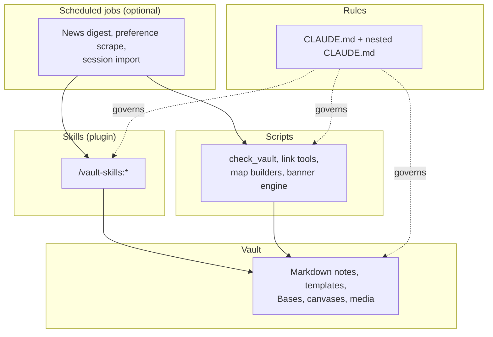

# Architecture

The system has five layers, and each has one job and one set of writers. The vault holds the records. A rules file tells assistants how to treat them. Skills do multi-step work on request. Scripts do mechanical checks and builds. Scheduled jobs run a few of those on a clock. Keeping the layers separate means you can change one without breaking the others, and that every kind of data has exactly one writer.

## The layers

| Layer | Lives in | What it is | Rule of thumb |
| --- | --- | --- | --- |
| **Vault** | The folders in `vault-template/` | Notes, templates, Bases, canvases, media | Plain files are the source of truth |
| **Rules** | `CLAUDE.md` at the root, plus nested ones | House rules an assistant loads automatically | The more specific file wins |
| **Skills** | `plugins/vault-skills/skills/<name>/` | Multi-step workflows, invoked as `/vault-skills:<name>` | Read config, ask once for gaps, preview before writing |
| **Scripts** | `scripts/` | Standard-library Python for checks and builds | Preview by default; never parse the YAML config |
| **Scheduled jobs** | Your OS scheduler (launchd, cron, Task Scheduler) | Runs a skill or script on a clock | Optional; narrow permissions; log somewhere outside the vault |

### Config

Skills read `.vault-skills.yaml` at the vault root (see [CONFIG.md](CONFIG.md)). Scripts never read it: a skill reads the YAML and passes folder names as flags such as `--vault` and `--daily-folder`. The vault's own `CLAUDE.md` overrides a skill where they differ.

## Who may write where

| Area | Written by | Notes |
| --- | --- | --- |
| Notes you author | You | Always wins |
| Generated blocks between markers | Scripts or skills | Rewritten on refresh; text outside the markers is never touched |
| `Daily Notes/` | You, `link_daily_notes.py` (properties and the Related block only) | New notes start from the template |
| `Tasks/` | The ticket sync skill | One way from the tracker; never writes back |
| `People/`, `Meetings/`, `Projects/` | You and capture skills | Created from templates after a confirmed plan |
| `News/`, `Preferences/` | Their skills | Read-only toward everything outside the vault |
| `Media/Banners/` | You, after reviewing a render | The engine writes to a scratch folder |
| `Local/` | Anything machine-local | Never synced or committed |
| `.obsidian/`, `.trash/` | Obsidian | Tools leave them alone unless you ask |

Rules that hold everywhere: re-read before editing, use small anchored edits, preserve UTF-8 and line endings, and never stage, commit, move, rename or delete unless you asked. When delegating to sub-agents, use read-only agents for exploration and keep edits in one agent so changes do not collide.

## Links and area maps

Notes are connected by wiki-links, and the graph is checked, not assumed.

- `check_vault.py` resolves links the way Obsidian does and reports the unresolved ones.
- `link_graph_report.py` counts, per area, the notes with no inbound link, no outbound link, or neither. It is a baseline for linking work.
- `link_daily_notes.py` chains daily notes with `prev`/`next` and lists notes from the same day in a generated **Related** block.
- **Area maps** (`build_area_maps.py`) draw one Canvas per top-level folder: a header card, then a card per subfolder. The **vault map** (`build_vault_map.py`) draws one card per area and links each area map. Counts come from the vault at build time, so a rebuild refreshes them. Both preview by default.

## Hubs, Bases and dashboards

A **hub** is a note that introduces an area and embeds its views. A **Base** (`.base` file) is a live table or card view over notes filtered by folder and `type`. The **Home** note is the front door: a dashboard of stats, recent work and "needs attention" lists. Because views read properties, the same record appears wherever it is relevant without being copied.

## Session importer (optional, not shipped)

Some people turn their AI assistant sessions into notes so past reasoning sits beside the work it produced. This repository does **not** include an importer; the idea is described here so you can build one.

- A scheduled script reads the assistant's local session logs and writes one note per session into a generated folder (for example `Media/Chats/`).
- Each note keeps its frontmatter and any text *you* add outside a `<!-- transcript -->` block; a refresh rewrites only the block. If you edit inside the block, the note is skipped.
- Transcripts are redacted for common credential formats before writing, and the importer needs no network or API key.
- A hub note links every session so each has at least one graph edge, and the folder is left out of link statistics (`link_graph_report.py --generated`).
- Per-account folders keep work and personal sessions apart, and a machine that must not read work notes never imports them.

If you build one, give it a tracking note, a preview mode, and tests that prove user text survives a refresh.

## Scheduled jobs (optional)

Anything on a schedule should be narrow: a fixed prompt or command, the smallest tool allowlist that works, read-only toward outside systems, output into one named folder, and logs outside the vault. Good candidates are a daily news digest and a daily preference scrape. Bad candidates are anything that commits, posts or sends.

## Two machines, one vault

If you use more than one computer, give each kind of data one writer and one carrier:

- **Obsidian Sync** (or another file sync) carries notes, attachments and settings.
- **Git** is the backup, and the only carrier for hidden folders such as `.claude/` and plugin folders.
- One machine is the committer. Others commit by explicit path, never with a blanket add, so a machine that lacks some tracked files cannot delete them.
- `Local/` holds machine-local files that neither sync nor git should pick up.

[Back to the index](README.md)
