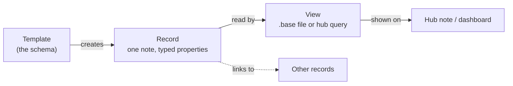

# Philosophy

This is the thinking behind the starter vault and its tooling. A vault like this is one private place for your work, your life and your reference material, built from plain Markdown files that you, Obsidian, scripts and an AI assistant can all read and write. The rules in your `CLAUDE.md` tell an assistant what to do; this page explains why, so that when a case is not covered you can reason your way to the right answer. Where a rule and this page disagree, the rule wins and this page needs updating.

## What the vault is for

- **One place for a whole life.** Work, personal notes, projects and reference live together, separated by folder and by note type, not by app. Because it holds private material, privacy shapes every other decision.
- **Capture first, file second.** Getting a thought down should take seconds. Raw input lands in the daily note, and a capture step later files it into linked records and real tasks. The raw text stays in the daily note as the source.
- **Pleasant to come back to.** A vault you enjoy opening is a vault you keep using. Banners, icons and a good dashboard are deliberate investments (see [aesthetics](aesthetics.md)).
- **A record you can trust.** Notes say what happened, with sources. Anything generated keeps facts, inferences and proposals apart, and never invents decisions, owners, deadlines or completion states.

## Records, with views on top

Every real thing gets its own note: a person, a project, a ticket, a meeting, a place, a recipe. Frontmatter properties (`type`, `status`, `summary`, `reviewed`) turn the note into a **record**. Hubs and `.base` files are **views** over those records, not copies of them. A **template** decides what a record looks like in the first place.

Change a property and every view updates. Because views match property values exactly, those values are **functional**: a Base that filters on `status = "Active"` will not see `active`. Keep functional values exactly as the template writes them.

## Templates are the schema

Consistency comes from starting every note from its template, not from a separate validator. When no template fits, copy the frontmatter of a nearby note instead of inventing a new shape. New note types, new tags and broad renames happen only when you decide they should, ideally together with a template and a Base that will use them.

## Links over hierarchy

Folders give a note a rough home; wiki-links and Bases do the real organizing. A note about a person lives in `People/`, but it is *found* through the meetings that link to it, the project that mentions it and the Base that lists it.

- Prefer descriptive file names and `[[wiki-links]]`.
- Move and rename through Obsidian (or its CLI or MCP) so links follow. A filesystem `mv` leaves broken links behind.
- Treat a broken link as a bug. `scripts/check_vault.py` finds them.

## Functional markers versus decoration

Some symbols do work: task metadata such as `📅 ⏳ ✅ 🔁`, status values, and heading text that other notes link to. Leave them exactly as they are. Decoration is everything else, and decoration uses icon shortcodes (`:TwCalendar:`). Never "tidy up" a functional emoji into a shortcode.

## Plain files, local tools

Markdown files are the source of truth. Obsidian, its plugins, the scripts in `scripts/` and AI assistants are all just tools that read and write those files. The scripts use the Python standard library and run on your machine. If every tool disappeared tomorrow, you would still have a folder of readable text.

## A record you can trust

Three habits keep the record honest:

1. **Facts, inferences and proposals are labelled apart.** "The deploy failed at 14:02" is a fact; "probably the cache" is an inference; "retry with a larger node" is a proposal. Generated notes keep them in separate places.
2. **Generated text has a fence.** Machine-written sections sit between marker comments such as `<!-- related-notes -->`. Anything outside the markers survives every refresh, and a note edited inside the markers is skipped rather than overwritten. The machine yields to the human.
3. **History is kept, not rewritten.** Project notes carry a dated changelog, newest first. A retired system becomes a frozen archive, not a deletion. Old layouts are left alone until you choose to migrate them.

## Preview before you write

Anything that can change many notes shows its plan first.

- Scripts preview by default and need `--write` to act (`link_daily_notes.py`, `add_obsidian_frontmatter.py`, the map builders).
- Skills that touch many notes show one plan for confirmation before writing.
- Risky development happens in a scratch copy, and banner renders go to a scratch folder to be reviewed before they enter the vault.

## Small, anchored edits

Several writers may touch a note: you, Obsidian, sync, scripts and an assistant. So every edit starts by re-reading the target, changes the smallest anchored piece of text, preserves UTF-8 and line endings, and never reformats unrelated text.

## Honest checks

Checks are read-only and report; they never silently fix. Judge a change by what it introduced, compared with a baseline of what was already wrong, and never describe a failed check as passing. If a check cannot run, say so.

## Humans approve the outward-facing steps

Commits, pushes, moves, renames and deletes happen only when you ask. Skills that touch outside systems (issue trackers, chat, mail, calendar) are read-only by default; a skill whose purpose is to write shows you the text first and writes only what you approve. Secrets and plugin configuration are never echoed, committed or overwritten. Sensitive areas, such as health records, are kept exactly as recorded and never turned into advice.

## Every automation documents itself

Each skill or scheduled job has a tracking note recording its behavior, source files, the verification actually run and a dated changelog. Updating that note is part of the change, not an afterthought.

## Recorded tensions

A trustworthy philosophy admits where practice falls short. Keep a short list of known gaps and do not pretend they are plans. Typical ones:

- Older notes predate the tagging rules: some lack a `type`, and tags vary in case.
- Some tools depend on one operating system or one machine, so "runs everywhere" holds only for the rest.
- Icon packs do not travel through Obsidian Sync, so an icon added on one machine may show as raw text on another until the file is copied over.

Writing these down is what lets you fix them later, on purpose, instead of rediscovering them by surprise.

## Where to go next

[Tagging](tagging.md) · [Aesthetics](aesthetics.md) · [Workflows](workflows.md) · [Architecture](architecture.md)
