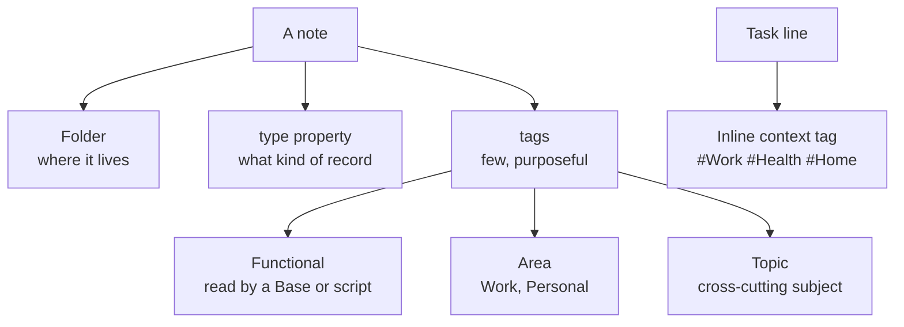

# Tagging

Tags are the weakest classifier in a vault that has folders, properties and links, so this starter keeps them few and purposeful. A note's folder and its `type` property say what it is, and every Base filters on them. Tags are kept for four jobs that properties do badly: feeding a handful of functional views, marking an area (work or personal), naming a cross-cutting topic, and giving an inline task a context. This page lists the taxonomy, the rules for adding tags, and a cleanup checklist.

## The shape of the taxonomy



Classification order, strongest first: **folder, then `type`, then tags.** Never add a tag that merely repeats the folder or the `type`.

## `type` values

`type` is functional. Bases compare it as exact text, so `Recipe` and `recipe` are different values. Use the value the template writes, and copy it from nearby notes when no template exists.

| `type` | Used for | Set by | Read by |
| --- | --- | --- | --- |
| `Daily Note` | One note per day | Daily note template | Daily notes Base |
| `project` | A project's main note | Project template | Projects Base |
| `task` | One note per ticket or issue | Task template | Task Base |
| `meeting` | One note per meeting | Meeting template | Meeting Base |
| `person` | One note per person | Person template | People Base |
| `Wiki` | Durable reference | Wiki note template | Wiki Base |
| `news-digest` | A generated news digest | The news skill | News Base |

Add a new `type` only when a template and a Base will use it. A new value is a singular noun and matches the case convention you already use.

## Kinds of tag

### Functional tags

These are read by a Base, a query or a script, so their spelling and case are part of the contract. Keep a short table of them in your own `CLAUDE.md`.

| Tag | Goes on | Why it matters |
| --- | --- | --- |
| `person` | Every person note | The People views and name-linking tools look for it |
| `family`, `friend`, `colleague` | People, by relationship | Sub-views of the People Base |
| `clippings` | Web-clipped notes | Splits clippings from your own writing |

### Area tags

`Work` on work notes and `Personal` on personal notes that live outside a personal folder. Use them only if a view or search will use them; otherwise the folder already says it.

### Topic tags

A cross-cutting subject such as `Python`, `Kubernetes` or `Finance`. One or two per note is plenty. Reuse an existing spelling; check the tag pane first.

### Inline task context

A tag at the end of a task line gives the task a context that travels into any Tasks query:

```markdown
- [ ] Refill prescription #Health 📅 2026-10-20
```

| Tag | Context |
| --- | --- |
| `#Work` | Work tasks |
| `#Health` | Health, medication, appointments |
| `#Home` | House and household chores |
| `#Finance` | Money and bills |
| `#Habits` | Recurring habits |
| `#Vault` | Work on the vault itself |

Use one context tag per task. Add a new one only for a context that will recur. Keep these tags away from the Tasks emoji markers so `📅 ⏳ ✅ 🔁` still parse. A `#` inside a URL is part of the link, not a tag.

## Rules for new notes

1. **Start from the template.** Its `type` and tags are the standard for that kind of note.
2. **Classify with folder and `type`, not tags.**
3. **Give every note at least one tag.** An untagged note shows up on the dashboard's "needs attention" list, which is the gardening queue. Generated notes are the exception.
4. **Add a tag only when it helps you find or filter across folders.**
5. **Reuse an existing spelling.** Obsidian treats `#AWS` and `#aws` as one tag in search, so case variants mostly look untidy, but a Base that tests `file.tags.contains("AWS")` is exact. For a genuinely new tag, capitalize it and join words with hyphens (`Home-Network`), and keep acronyms in capitals. Functional tags stay as the table spells them.
6. **Do not spread a tag hierarchy.** Nested tags (`type/project`, `area/work`) add typing for little gain once Bases filter on properties. If a template already writes some, leave those; do not start new ones elsewhere.
7. **Stop adding noise tags:** `note`, the note's own date, and `dailynote` or its variants.

## Frontmatter versus inline

| Where | Use for |
| --- | --- |
| Frontmatter `tags:` list | Note-level tags: area, topic, functional |
| Inline `#tag` in prose | Rarely. Prefer a link to a note |
| Inline `#tag` on a task line | Task context only |

Write frontmatter tags as a YAML list, one per line, without the `#`:

```yaml
tags:
  - Work
  - Kubernetes
```

## How Bases and Dataview use tags

- Bases filter on folder and `type` first, so most views never read a tag.
- A functional tag is tested with an exact list check such as `file.tags.contains("person")`.
- Tasks queries filter on the inline context tag, for example `tags include #Health`.
- Dataview queries can read both. Before renaming any tag, search your query blocks and `.base` files for the old spelling.

## Cleanup checklist

Run this as part of the [vault garden](workflows.md#the-vault-garden) routine, preview first.

- [ ] Scan frontmatter for tags that differ only in case, and pick one spelling each.
- [ ] Find notes with no `tags` (the "untagged" view) and add one or accept that they are generated.
- [ ] Drop noise tags: `note`, date tags, `dailynote`.
- [ ] List notes with no `type` outside folders that have their own convention, and add the template's value.
- [ ] Search queries and Bases for a tag *before* renaming it. Rename only what nothing reads.
- [ ] Make the change with a script that supports preview (`scripts/add_obsidian_frontmatter.py` covers notes with no frontmatter at all), then review the diff.
- [ ] Record the pass: what changed, how many notes, and what was left alone and why.

## Known gaps

Write down what you are not fixing, with counts. For example: "N notes have no frontmatter", "one folder uses `type: Project` while the Base matches `project`". A recorded gap is a decision; an unrecorded one is a surprise.

[Back to the index](README.md)
