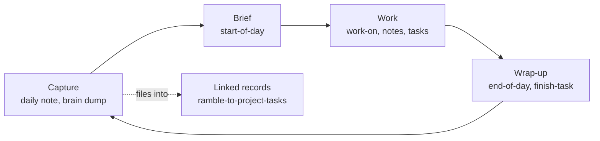
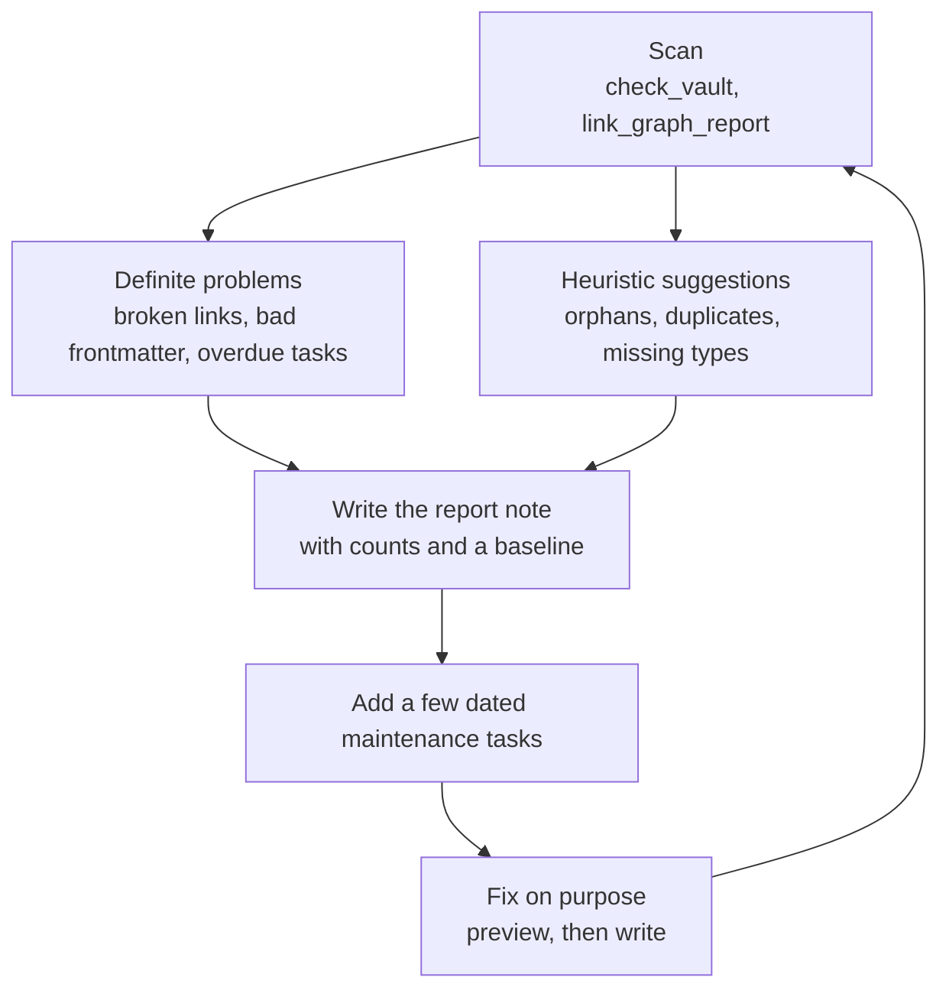

# Workflows

The vault works best as a loop with a few routines around it. You capture without friction, start the day with a brief, work from linked records, and close the day by writing down what is true. Weekly and monthly routines keep the whole thing healthy. This page walks the daily loop, the weekly review and the vault garden, and shows where each skill fits. Skills run as `/vault-skills:<name>`; each one reads its settings from `.vault-skills.yaml` and asks once for anything missing.

## The daily loop



### 1. Capture

Open today's daily note (created from the daily template) and write. Do not file anything yet. If you have a larger brain dump, typed or dictated, run `/vault-skills:ramble-to-project-tasks`: it files people, meetings, places and project updates into linked records, turns commitments into real Tasks-plugin tasks attached to their project, and shows you one capture plan to confirm first. It records; it never carries out the tasks.

### 2. Brief

`/vault-skills:start-of-day` compares the plan you left yourself yesterday with live state (issues, pull requests, chat, mail, calendar, open tasks), tells you what changed overnight and what needs you first, and, with your approval, updates today's entry. Mail and calendar come from `/vault-skills:mail-calendar`, which reads the local copies read-only and never sends, replies or responds to an invite.

### 3. Work

- `/vault-skills:work-on` takes an issue key or a project name and gives a briefing: the task note, linked pull requests and branches, related meetings and mail, and the next steps.
- `/vault-skills:jira-to-obsidian-sync` keeps one note per ticket up to date, one way only (it never writes to the tracker).
- `/vault-skills:meeting-recording-notes` turns a recording into a speaker-labelled transcript and a finished meeting note with decisions and action items.
- `/vault-skills:add-person` creates or completes a person note from your directory sources.
- `/vault-skills:draft-in-voice` drafts a chat message, ticket comment or PR description in your own style and saves it as a draft; it never posts.
- `/vault-skills:pr-reactions` marks your announced pull requests as merged once they are.

### 4. Wrap-up

`/vault-skills:end-of-day` records what happened, what is blocked and what tomorrow starts with, so the next brief has something true to compare against. When a whole task or session is done, `/vault-skills:finish-task` verifies the work (checks, tests), updates tracking notes and hubs, files real open follow-ups, and commits only if you approve.

The loop is deliberately boring. The value is that each step reads what the last one wrote down.

## The weekly review

Once a week, in a weekly-review note kept beside the daily notes:

1. Read the week's daily notes and meeting notes; move loose ideas into records.
2. Clear the **Task inbox**: every open task gets a date, a project, or a cancel (`❌` with the date).
3. Look at each active project: bump `reviewed`, update `status`, and note the next action.
4. Scan the dashboard's "needs attention" views: untagged notes, notes with no `type`, overdue tasks.
5. Write three lines: what went well, what slipped, what next week is for.

## The vault garden

A short, read-mostly maintenance pass, weekly or monthly. It finds problems and proposes fixes; it does not make them silently.



Each pass produces one dated note in a maintenance folder of your wiki (say `Wiki/Vault Maintenance/`), named like `2026-10-14 Vault Garden`, with these sections:

| Section | Contents |
| --- | --- |
| Scope | What was scanned and what was excluded, so counts are comparable |
| Definite problems | Broken links, unclosed frontmatter or fences, duplicate settings files, overdue tasks |
| Verified clean checks | What you looked for and did not find, so silence means something |
| Cleanup opportunities | High-confidence fixes first, then heuristic suggestions |
| Connection opportunities | Hubs that should link to orphans, anchors worth stabilising |
| Vault health | Counts compared with the previous pass |
| Suggested maintenance tasks | A few dated Tasks lines |

Run the tools read-only first:

```
python scripts/check_vault.py --vault <vault>
python scripts/link_graph_report.py --vault <vault>
python scripts/link_graph_report.py --vault <vault> --list Wiki
python scripts/link_daily_notes.py --vault <vault>        # preview; add --write to apply
```

Judge each change by what *it* introduced against the previous baseline, never describe a failed check as passing, and leave unrelated findings alone.

## Periodic extras

| Routine | Skill or script | Rhythm |
| --- | --- | --- |
| News and release digest | `/vault-skills:get-news` | Daily, can run on a schedule |
| Learn how you like work done | `/vault-skills:learn-preferences` | Daily or weekly delta |
| Rebuild maps | `scripts/build_area_maps.py`, then `build_vault_map.py` | After structural changes |
| New banner | `/vault-skills:pixel-banners` | As needed |
| Person photo as icon | `/vault-skills:vault-image-icon` | As needed |

## Format helper skills

`/vault-skills:obsidian-markdown`, `obsidian-bases`, `json-canvas` and `obsidian-cli` teach an assistant the file formats and the command line so notes, Bases and canvases come out valid. `/vault-skills:mermaid-image` renders a Mermaid diagram to an image when a destination cannot render Mermaid itself.

[Back to the index](README.md)
