# Claude & Obsidian, a Match Made in Markdown

A talk by Kyle McIntire about how one Obsidian vault plus Claude Code grew into a working system for a platform engineer's
day: capture, briefings, upgrades, a compliance boundary, and the daily loop. It was given to a platform team at work. The
point is not to sell Obsidian; it is to show a pattern you can copy one piece of this week. The vault in the talk is the one
this repo was extracted from, so most slides link to the matching doc or skill.

**Two cuts.** The full deck has 35 slides. Seventeen of them, tagged ⏱️ below, form the 20-minute cut.

**Open it locally.** Clone the repo and open [`index.html`](index.html) in a browser (it is one self-contained file; the
media sits next to it in `media/`). Keys:

| Key | Does |
| --- | --- |
| `→` `Space` / `←` | next / previous slide (or click the right or left half) |
| `n` | show the speaker notes |
| `f` | fullscreen |
| `s` | switch between the full deck and the 20-minute cut (same as adding `?short` to the address) |

> 🔒 **The recordings are pixelated on purpose.** Every clip and screenshot is from the author's real vault, made unreadable
> for privacy; only the shapes and layout survive. The graph animation on slide 4 has no text and is left as is. Work
> specifics in the text (employer, repos, channels, people) have been generalised.

The stills below are rendered from `index.html`; the narration is the speaker notes, written up as prose.

**Contents:** [1 · The pattern](#1-title) · [2 · A platform engineer's day](#11-a-platform-engineers-day) ·
[3 · Trust and start](#25-guardrails-are-the-design) · [Make your own](#make-your-own)

---

## 1. Title

⏱️ 20-min cut

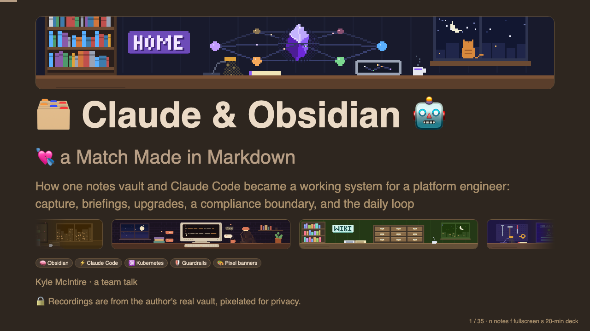

Claude & Obsidian, a match made in Markdown. One notes vault plus Claude Code, and the system that grew around it, told
from a platform engineer's side: EKS upgrades, Bottlerocket and Karpenter pins, a compliance boundary, PR reviews and
standups. The aim is to show the pattern so you can copy one piece of it, not to sell you on a particular editor.

## 2. Agenda

⏱️ 20-min cut

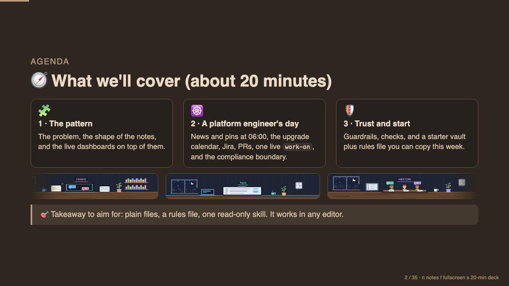

Three parts. First the pattern: records, views and templates, shown in the real vault. Then the workday: the skills that
carry a platform engineer's day, from the 06:00 news digest to the standup note, with one live briefing and the boundary
rules. Finally trust, and a starter kit you can copy, including the [template vault](../../vault-template/) in this repo.
The takeaway to aim for: plain files, a rules file, one read-only skill.

## 3. The platform team problem

⏱️ 20-min cut

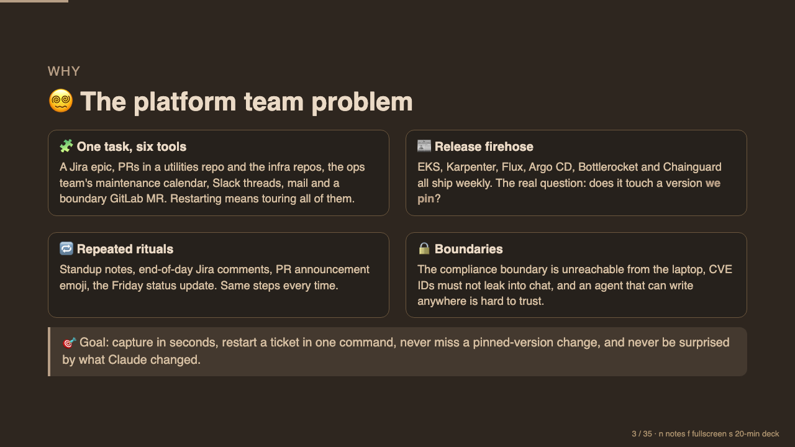

One upgrade touches a Jira epic, three or four PRs across a utilities repo and the infra repos, a Confluence maintenance
calendar, Slack announce channels, and for the regulated environment a GitLab MR inside a compliance boundary nobody can
see from the laptop. Restarting that after two days of interrupts means a tour of all of it. Meanwhile release notes for
EKS, Karpenter, Flux, Argo CD and Bottlerocket arrive faster than anyone reads them, and the real question is always
whether they touch a version you pin. Add repeated rituals and the trust problem of an agent that can write anywhere, and
you have the goal: capture in seconds, restart a ticket in one command, never miss a pinned-version change, and never be
surprised by what Claude changed.

## 4. What exists today

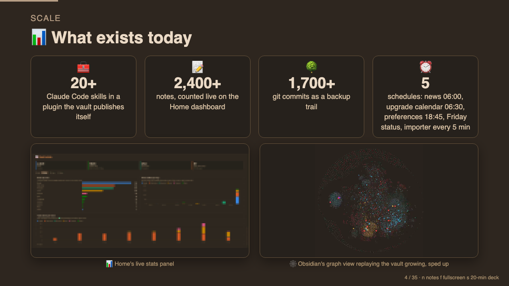

The numbers come from the vault itself: 2,400+ notes counted live on the Home dashboard, 1,700+ git commits as a backup
trail, and twenty skills, which this repo ships in [generalised form](../../plugins/vault-skills/skills/). Five things run
on a schedule without anyone touching them. It grew one annoyance at a time; the right-hand clip is Obsidian's graph view
replaying that growth.

## 5. The vault at a glance

⏱️ 20-min cut

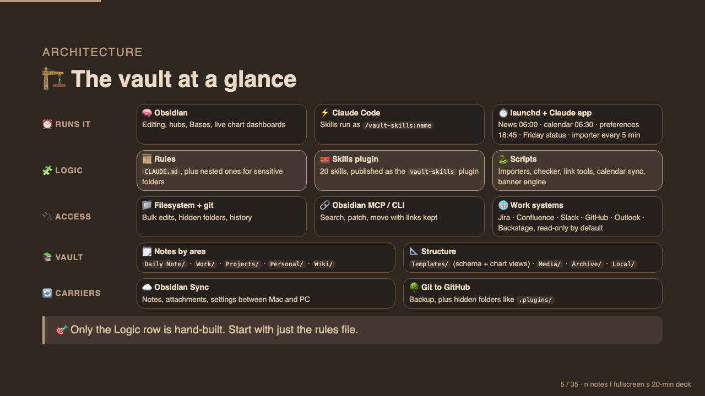

Read it bottom to top. Plain Markdown folders by area, with templates as the schema; Obsidian Sync carries notes between
machines and git is the backup and the only carrier for hidden folders. Access goes through the filesystem, the Obsidian
MCP and CLI, and read-only connectors to Jira, Confluence, Slack, GitHub and mail. The logic row (one rules file, the skills
plugin and a few Python scripts) is the only hand-built part; everything else is off the shelf. See
[architecture](../../docs/architecture.md) for the full layer diagram.

## 6. Records, views, templates

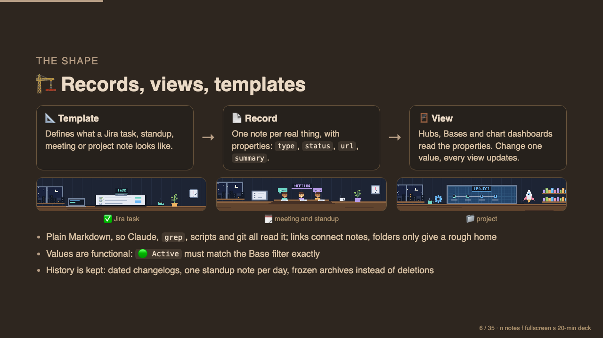

A Jira task, a standup, a person, a project: each is one note with properties. Views read those properties and never copy
them, so changing one value updates every hub. Templates are the schema; there is no validator because everything starts
from one. Values are functional, so `🟢 Active` must match the Base filter character for character. The reasoning is in
[philosophy](../../docs/philosophy.md#records-with-views-on-top).

## 7. Home: the command centre

⏱️ 20-min cut

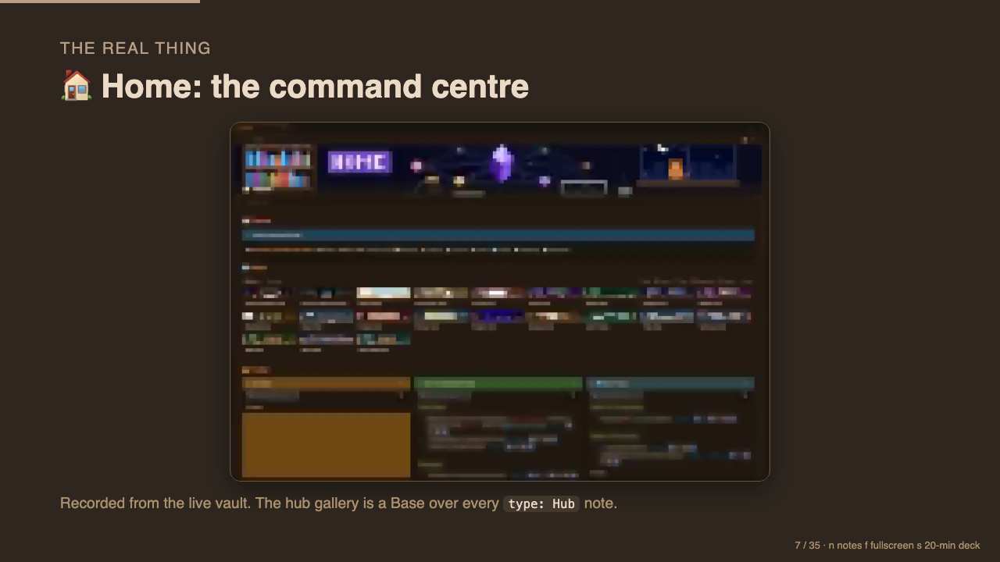

The real vault, recorded live. Home has a date line with links to today's note, standup, journal and the vault map, then a
gallery of every hub, each with its own pixel banner. Everything on it is a view over notes; nothing is copied. The
template's version is [`Home.md`](../../vault-template/Home.md).

## 8. Every hub has a live dashboard

⏱️ 20-min cut

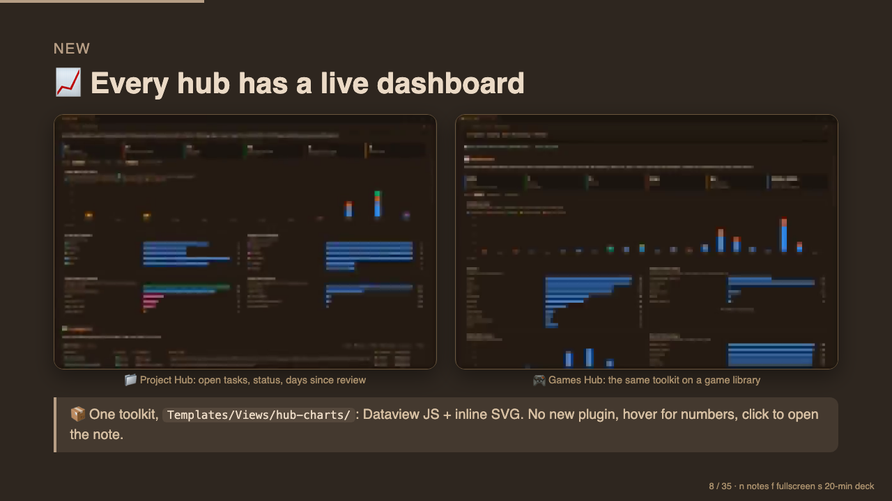

Every hub has a live chart dashboard, drawn by one shared toolkit with Dataview JS and inline SVG, so there is no extra
plugin and it works on desktop and phone alike. Hover for numbers, click a bar or a day to open the note behind it. The
same toolkit draws a project dashboard and a game library, because it works for anything with properties. Once your notes
have properties, a dashboard is one small script: see
[`Templates/Views/hub-charts/`](../../vault-template/Templates/Views/hub-charts/).

## 9. The work hubs and their dashboards

⏱️ 20-min cut

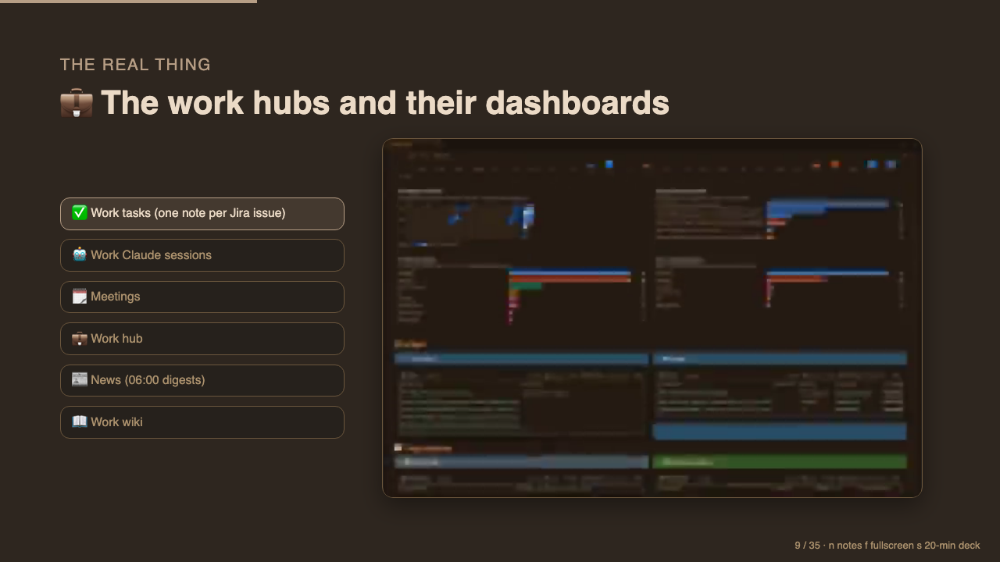

The work side, each with its dashboard. Work tasks are one note per Jira issue, synced one way from Jira, with story
points, subtasks done per week and a completion calendar. The work Claude-session hub charts cost, activity and tool calls
across every session; the meeting hub charts time in meetings and what you are waiting on. News holds the 06:00 digests and
the work wiki is the team reference. In the deck each clip plays through, then the next starts.

## 10. Home to a Jira task, in two clicks

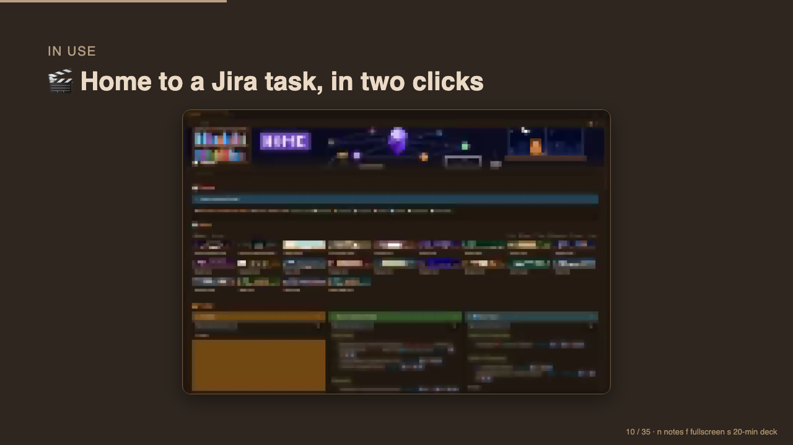

From Home, click the work tasks card, the task hub opens on its dashboard, scroll to In flight, click a ticket, and its
task note opens: the Jira description, acceptance criteria and the dated work log. Two clicks from anywhere to where you
left off.

## 11. A platform engineer's day

⏱️ 20-min cut

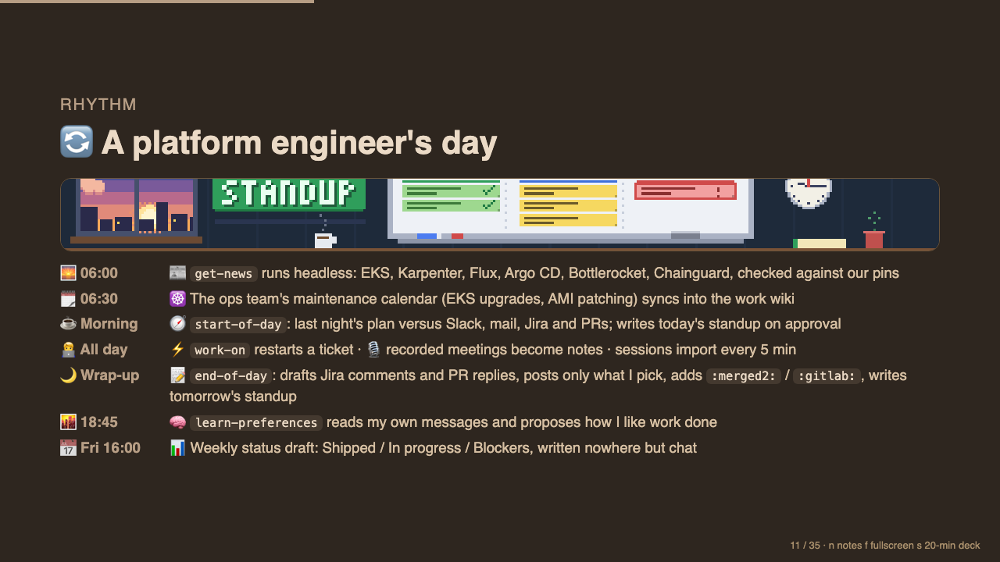

The day as it actually runs. Two jobs fire before you sit down: the news digest at 06:00 and the maintenance calendar sync
at 06:30. [`start-of-day`](../../plugins/vault-skills/skills/start-of-day/) checks last night's plan against what happened
overnight, [`work-on`](../../plugins/vault-skills/skills/work-on/) restarts a ticket, and recorded meetings become notes.
[`end-of-day`](../../plugins/vault-skills/skills/end-of-day/) drafts the Jira comments and PR replies, posts only what you
pick, marks merged PR announcements and writes tomorrow's standup. In the evening a job learns how you like things done.
The loop is written up in [workflows](../../docs/workflows.md#the-daily-loop).

## 12. `get-news`: releases, checked against our pins

⏱️ 20-min cut

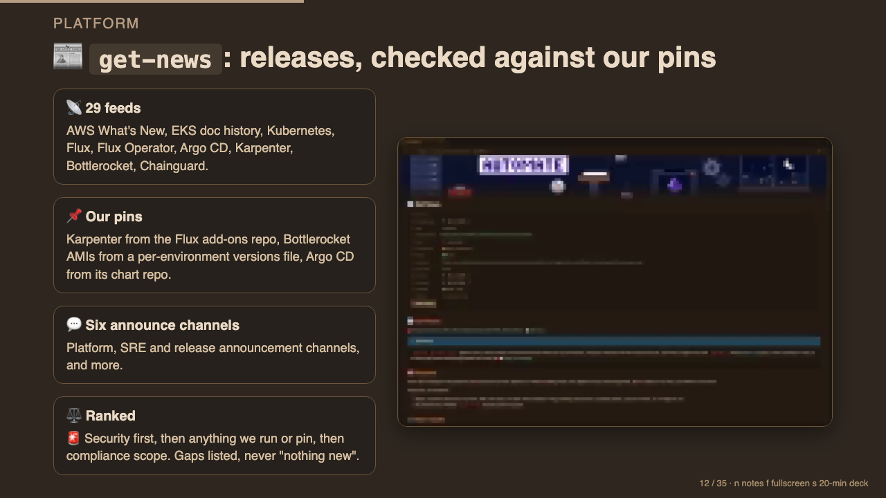

The one most people want. A standard-library script reads 29 feeds in parallel (AWS What's New, the EKS doc history, the
Kubernetes blog, and release feeds for Kubernetes, Flux, Flux Operator, Argo CD, Karpenter, Bottlerocket and Chainguard),
then reads the versions actually pinned in local clones of the infra repos. Each release is tagged as a newer patch of a
pin, a newer minor, or unrelated. The skill also reads the team's announcement channels, ranks security first, and writes a
digest note, listing any failed source under Gaps instead of claiming "nothing new". See
[`get-news`](../../plugins/vault-skills/skills/get-news/).

## 13. The upgrade calendar, in the vault

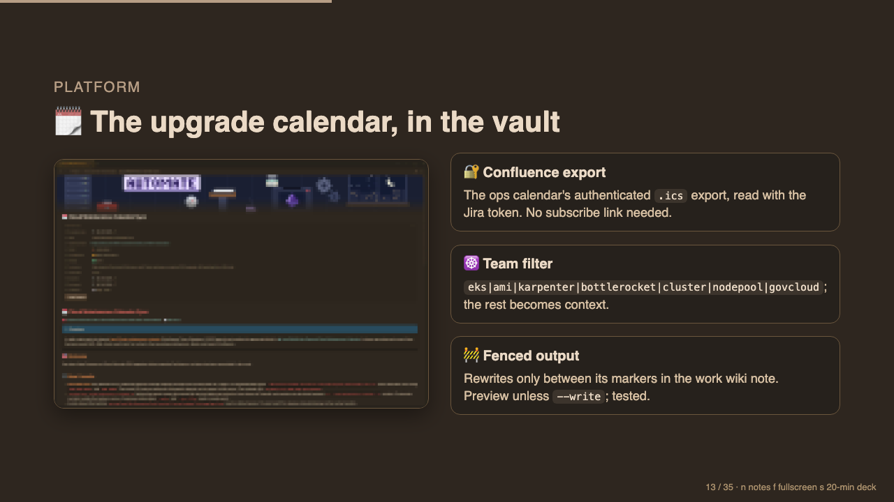

The company's cloud maintenance calendar lives in Confluence, and its iCal feed wants a login, so a desktop calendar can't
subscribe. A daily script pulls the authenticated export, keeps the events whose titles match EKS, AMI, Karpenter,
Bottlerocket, cluster or nodepool, and puts the rest in a context section. It rewrites only the block between its markers,
previews unless given `--write`, and has tests, so upgrade windows are searchable next to the tickets. (This script is
specific to one Confluence setup and is not shipped here.)

## 14. Jira sync and `start-of-day`

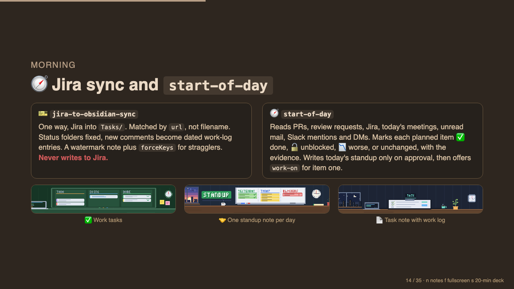

Two morning pieces. [`jira-to-obsidian-sync`](../../plugins/vault-skills/skills/jira-to-obsidian-sync/) is one way, Jira
into task notes, matched by the `url` property rather than the filename; it fixes status folders and copies new comments in
as work-log entries, tracked by a watermark note. It never writes to Jira.
[`start-of-day`](../../plugins/vault-skills/skills/start-of-day/) then marks each planned item done, unblocked, worse or
unchanged, with evidence, and its only write is today's standup note, after you approve the diff.

## 15. A briefing in one command

⏱️ 20-min cut

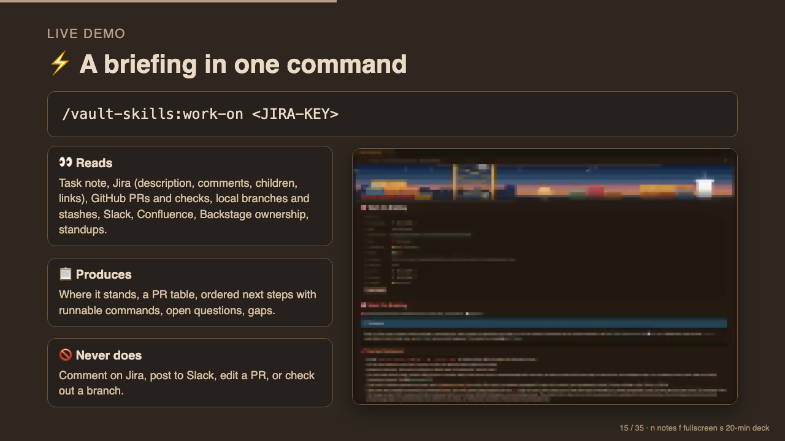

The live demo: `/vault-skills:work-on <JIRA-KEY>` on a real ticket. The briefing covers the task, where it stands, a PR
table, ordered next steps with runnable commands, open questions and gaps. It reads from many places (the task note, Jira,
GitHub PRs and checks, local branches, Slack, Confluence) and writes to none of them. If no task note exists, it runs the
Jira sync rather than inventing one. See [`work-on`](../../plugins/vault-skills/skills/work-on/).

## 16. The briefing, running in the terminal

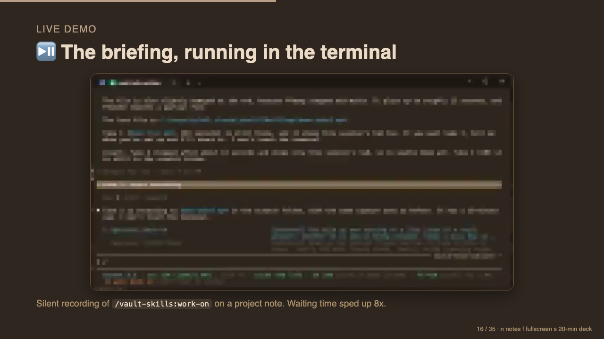

The backup for the live demo: a silent recording of the Claude CLI running `work-on` on the talk's own project note, with
waiting time sped up 8x so it runs about 35 seconds. It shows the command, the gatherer script, then the briefing.

## 17. Why the briefing can be trusted

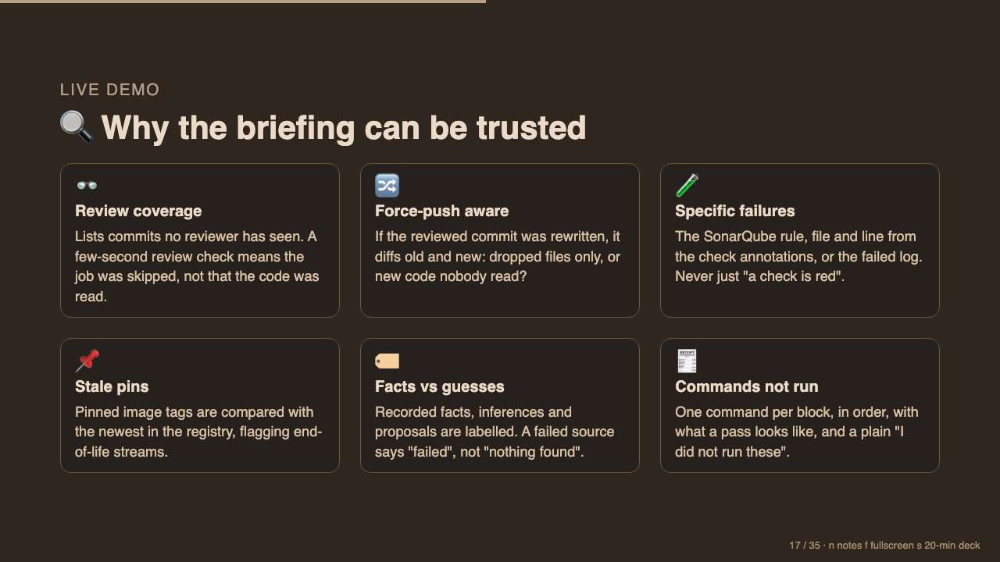

These are the things everyone has been bitten by. A green review check can mean the review job was skipped after a push,
so the briefing lists the commits no reviewer has seen, and if a force-push rewrote the reviewed commit it diffs old and
new. Failing checks are quoted with the rule, file and line, never just "a check is red". Pinned image tags are compared
with the newest in the registry, facts are labelled apart from guesses, and every command is marked as not run.

## 18. The compliance boundary is a rule, not a hope

⏱️ 20-min cut

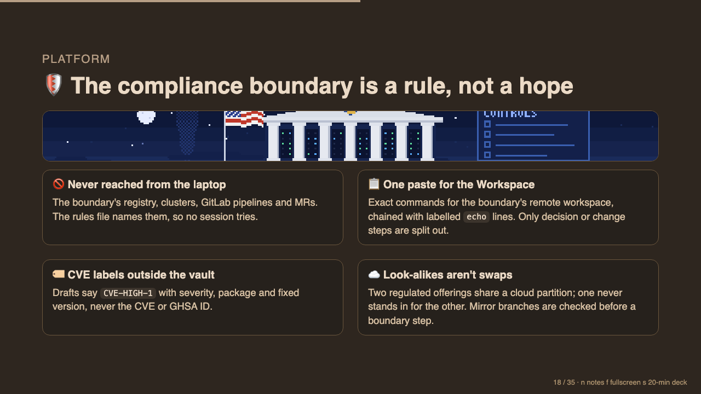

Anything inside the compliance boundary (its registry, its clusters, its GitLab pipelines) is unreachable from the laptop,
and the rules file says so, so Claude never tries. Instead it writes the exact commands for the boundary's remote
workspace, bundled into one paste with labelled `echo` lines, splitting out only steps that need a decision or change
something. In anything that leaves the vault, CVEs for boundary images become labels like `CVE-HIGH-1` with severity,
package and fixed version. And look-alike environments are not interchangeable: one never stands in for another.

## 19. `end-of-day`, PR emoji and the standup note

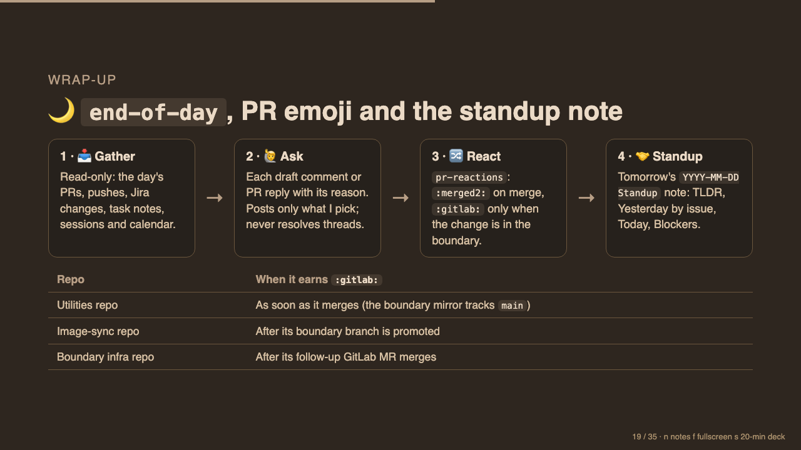

[`end-of-day`](../../plugins/vault-skills/skills/end-of-day/) is manual-only by design, because it can post. It gathers
the day read-only, finds stale PR descriptions, unanswered review threads and Jira issues with progress but no comment, and
shows each draft with its reason; it posts only what you pick and never resolves a thread. Then
[`pr-reactions`](../../plugins/vault-skills/skills/pr-reactions/) marks your own PR announcements: one emoji on merge, a
second only when the change is known to have reached the boundary, which differs per repo. Finally it writes tomorrow's
standup, one note per day.

## 20. Meetings, preferences and diagrams

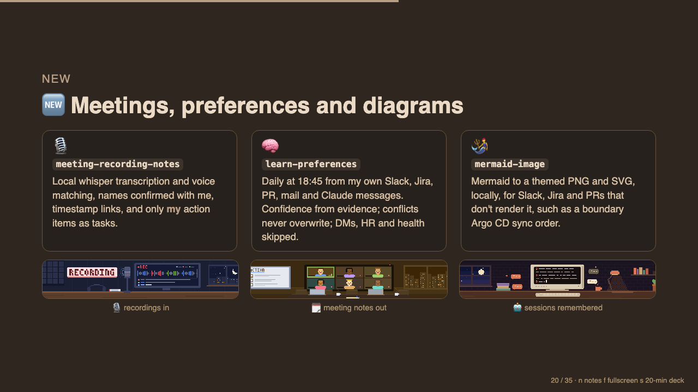

Three newer skills. [`meeting-recording-notes`](../../plugins/vault-skills/skills/meeting-recording-notes/) transcribes
locally with whisper and speaker matching, confirms names, and turns only your own action items into tasks.
[`learn-preferences`](../../plugins/vault-skills/skills/learn-preferences/) reads your own writing each evening and proposes
how you like things done. [`mermaid-image`](../../plugins/vault-skills/skills/mermaid-image/) renders Mermaid to a themed
PNG, because Slack and Jira don't render it.

## 21. `learn-preferences`: how it learns

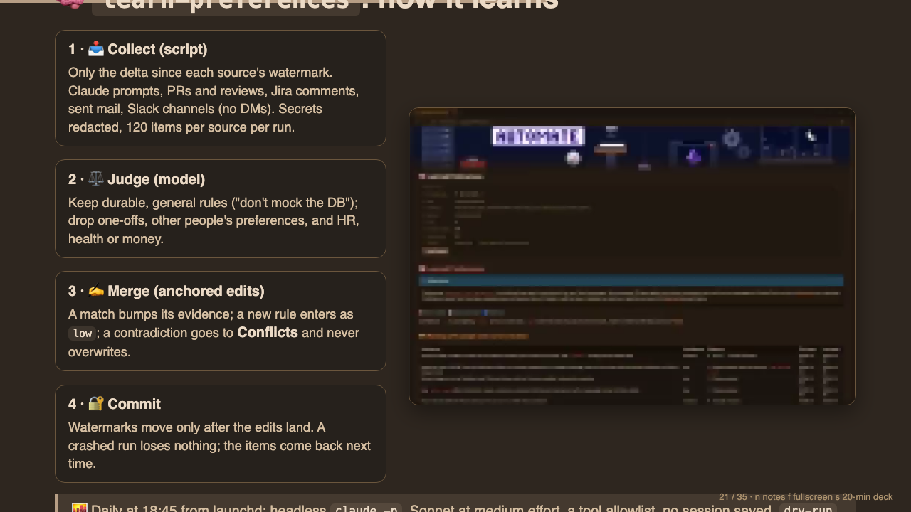

Every evening a scheduled job runs it headless. A script collects only what you wrote since the last run, per source
(Claude prompts, PR descriptions and reviews, Jira comments, sent mail, Slack channel messages but no DMs), redacts secrets,
and caps each source at 120 items. The model then keeps only durable, general rules and drops one-offs, other people's
preferences, and anything about HR, health or money. The merge is anchored edits into a profile note, and the watermarks
only move after the edits land, so a crashed run loses nothing.

## 22. Confidence comes from evidence, not wording

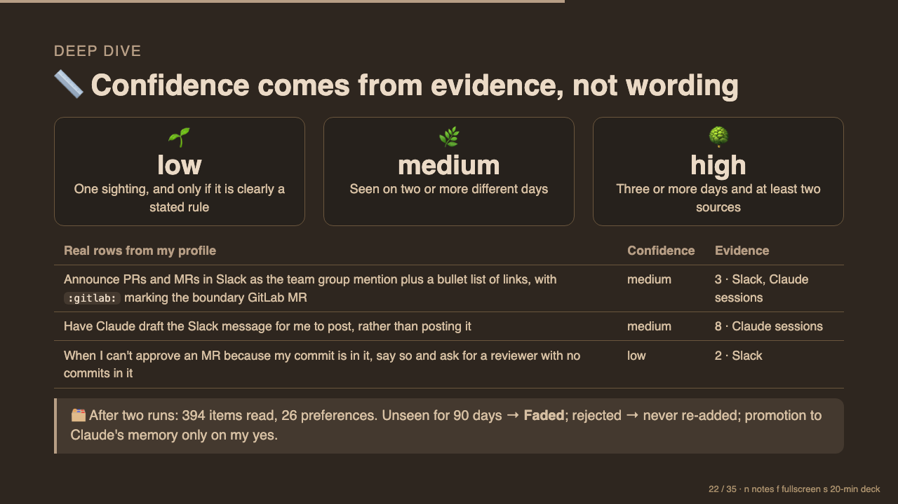

Confidence is computed, never taken from how strongly something was worded. One sighting is low, two different days make
it medium, and three days across at least two sources make it high. Rows unseen for 90 days fade, rejected rows are never
re-added, and a high row only goes into Claude's memory when you say yes in a live session. After two runs the real profile
held 26 preferences from 394 items.

## 23. Voice and Style: how I actually write

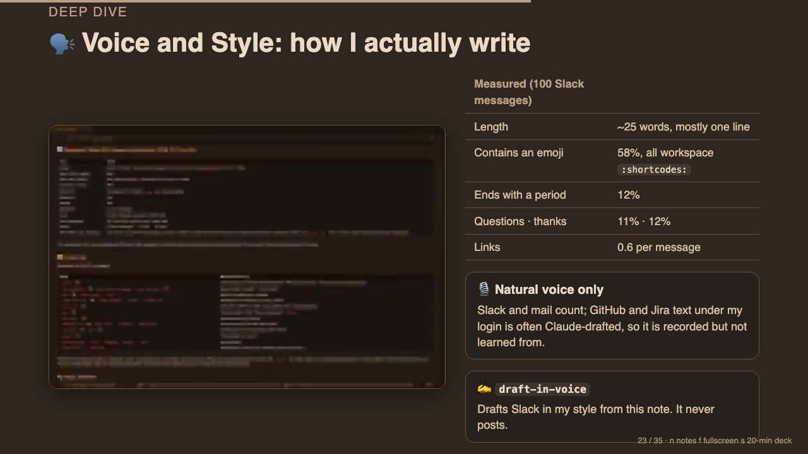

The same script measures how you write: length, bullets, code, links, mentions, questions, thanks, punctuation and emoji.
Only Slack and mail count as natural voice, because text on GitHub and Jira under your name is often Claude-drafted and
would teach it to sound like itself. [`draft-in-voice`](../../plugins/vault-skills/skills/draft-in-voice/) reads that note
to draft Slack messages that sound like you, and you still post them yourself.

## 24. Every automation has a tracking note

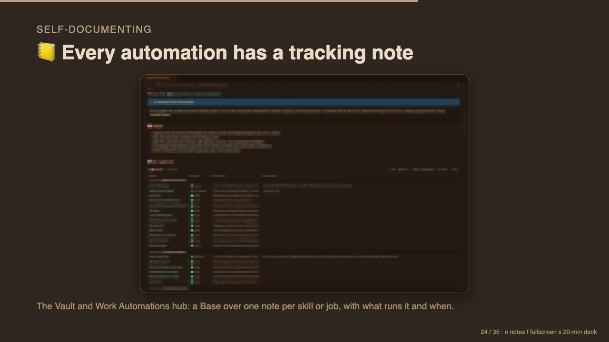

Every skill and scheduled job has a tracking note: status, summary, what runs it and when, source files, verification and
a dated changelog. The hub is a Base over those notes, with a Needs attention view for recorded follow-ups. When a skill
changes, its note changes in the same session. The template ships an
[`Automation Item Template`](../../vault-template/Templates/Automation%20Item%20Template.md) for this.

## 25. Guardrails are the design

⏱️ 20-min cut

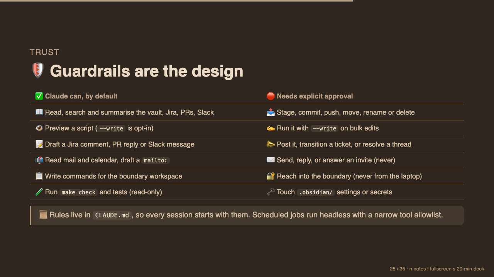

Spend time here. The rules live in a file Claude reads at the start of every session, scheduled ones included. Scripts
preview first, so writing is opt-in, and every outward action (a Jira comment, a Slack post, a commit) needs you to pick it.
Scheduled jobs run headless with a narrow tool allowlist, mail and calendar are read-only with a `mailto:` draft instead of
sending, and work notes stay with the work account. The template's version is
[`vault-template/CLAUDE.md`](../../vault-template/CLAUDE.md), and the reasoning is in
[philosophy](../../docs/philosophy.md#humans-approve-the-outward-facing-steps).

## 26. Checks, tests and a linked graph

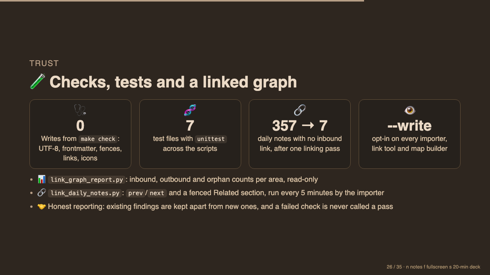

Verification is boring and important. The checker is read-only: invalid UTF-8, unclosed frontmatter and code fences,
unresolved links, and Iconize shortcodes no installed pack provides. A link graph report counts inbound and outbound links
per area, and a linking script gives every daily note `prev` and `next` links, which took daily notes with no inbound link
from 357 to 7. All of these are in [`scripts/`](../../scripts/README.md), with tests.

## 27. How fast it is

⏱️ 20-min cut

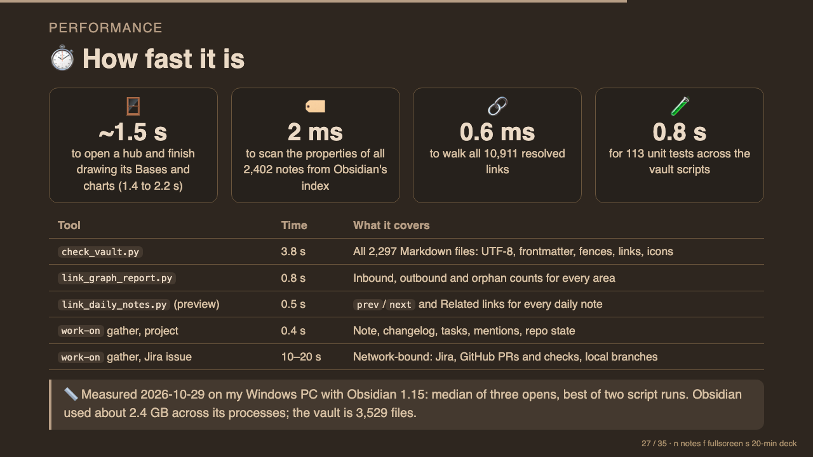

People always ask whether it gets slow. Opening a hub and waiting for every Base and chart to draw takes about 1.5
seconds. Obsidian keeps an in-memory index of properties and links, so scanning 2,400 notes takes 2 ms and walking eleven
thousand links under one, which is why Claude prefers the Obsidian MCP for property and link questions. The full vault check
runs under four seconds and 113 tests in under one; only the Jira briefing is slow, 10 to 20 seconds, because it waits on
the network. The cost is memory: Obsidian sat around 2.4 GB.

## 28. Two machines, two accounts

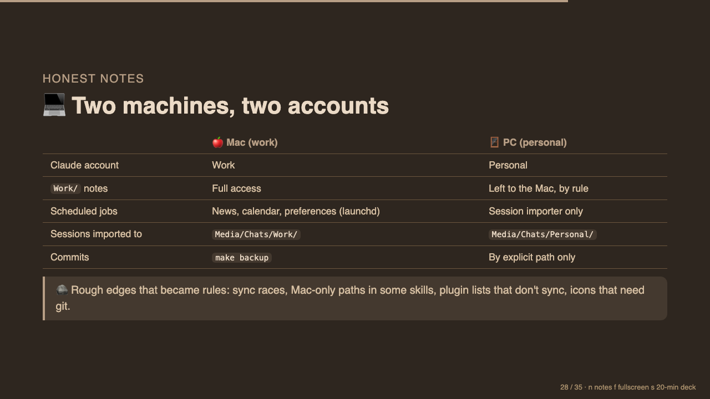

Two machines, two Claude accounts: work on the Mac, personal on the PC. Obsidian Sync carries the notes and git carries the
hidden folders; work notes stay with the work account by rule, and scheduled jobs run only on the Mac. Every rough edge (sync
races, machine-specific paths, plugin lists that don't sync) became a written rule so the next session doesn't repeat it. See
[Two machines, one vault](../../docs/architecture.md#two-machines-one-vault).

## 29. A vault you enjoy opening

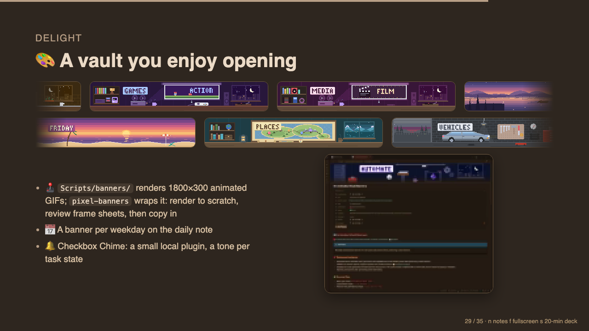

The fun part, and it matters. A small engine renders animated 1800×300 pixel-art banners in a house style; the
[`pixel-banners`](../../plugins/vault-skills/skills/pixel-banners/) skill renders to scratch, you review frame sheets, then
it copies them in. There is a banner per weekday on the daily note, and a tiny local plugin plays a tone when a task changes
state. A vault you enjoy opening is one you keep using; see [aesthetics](../../docs/aesthetics.md).

## 30. Every other hub

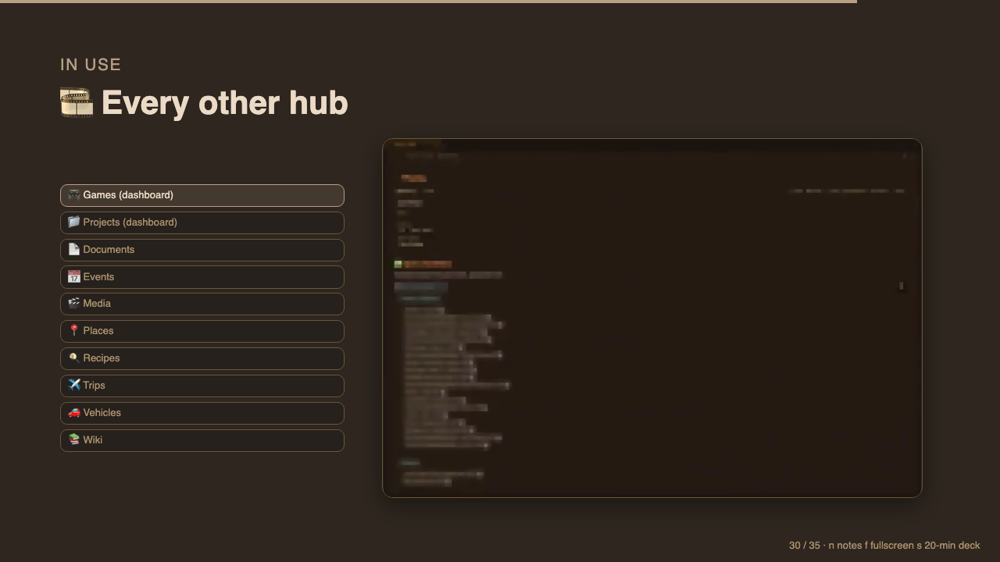

Every other hub, each playing through in turn: games, projects, documents, events, media, places, recipes, trips, vehicles
and the wiki. The point is the repetition: a banner, an overview, live views over records. A new area of life costs one
template and one hub.

## 31. A starter vault you can copy

⏱️ 20-min cut

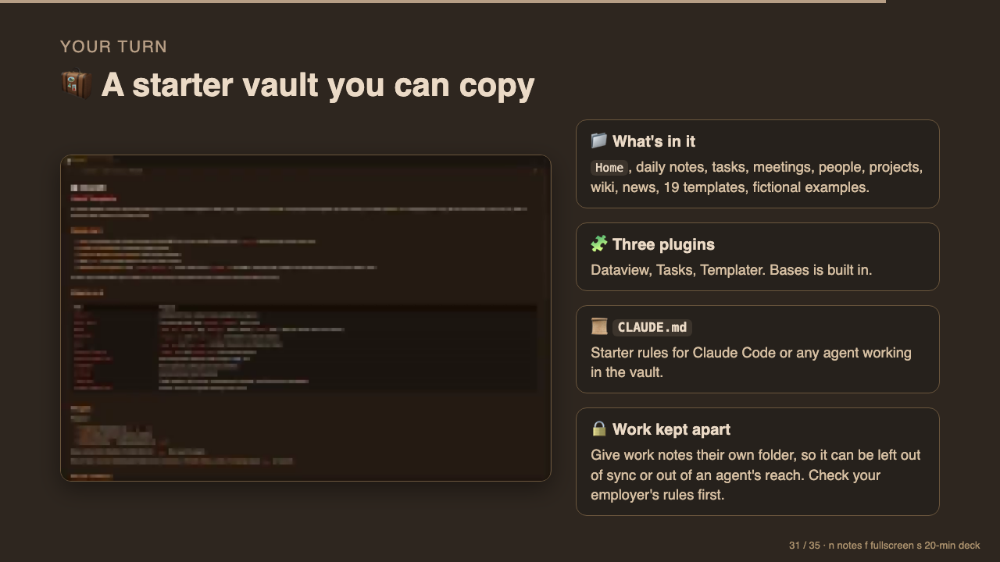

The most copyable thing here. [`vault-template/`](../../vault-template/README.md) is a stripped-down copy of this vault's
structure with no personal data: Home, daily notes, tasks, meetings, people, projects, a wiki, news, 19 templates, a
starter `CLAUDE.md` and fictional example notes. Dataview, Tasks and Templater do the work, and Bases is built in. Keep work
notes in a folder of their own so you can exclude it from sync or from an agent's reach, and check what your employer allows
first.

## 32. Map it to your own tool

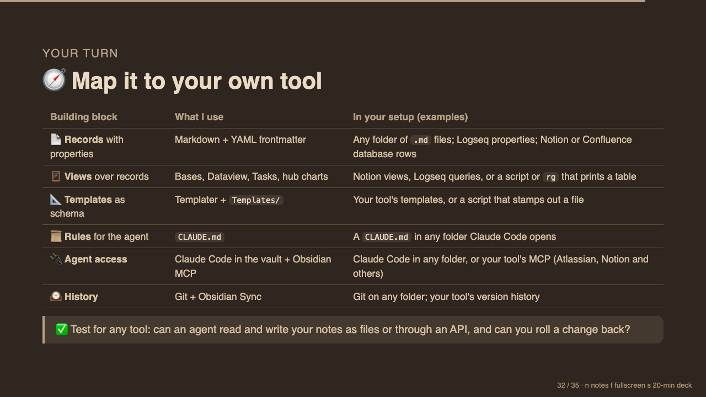

Everything rests on six building blocks (records, views, templates, rules, agent access and history), and none of them need
Obsidian. The examples column is illustrative, not a compatibility list. The test for any tool: can an agent read and write
your notes as files or through an API, and can you roll a change back?

## 33. A starter kit for any notes folder

⏱️ 20-min cut

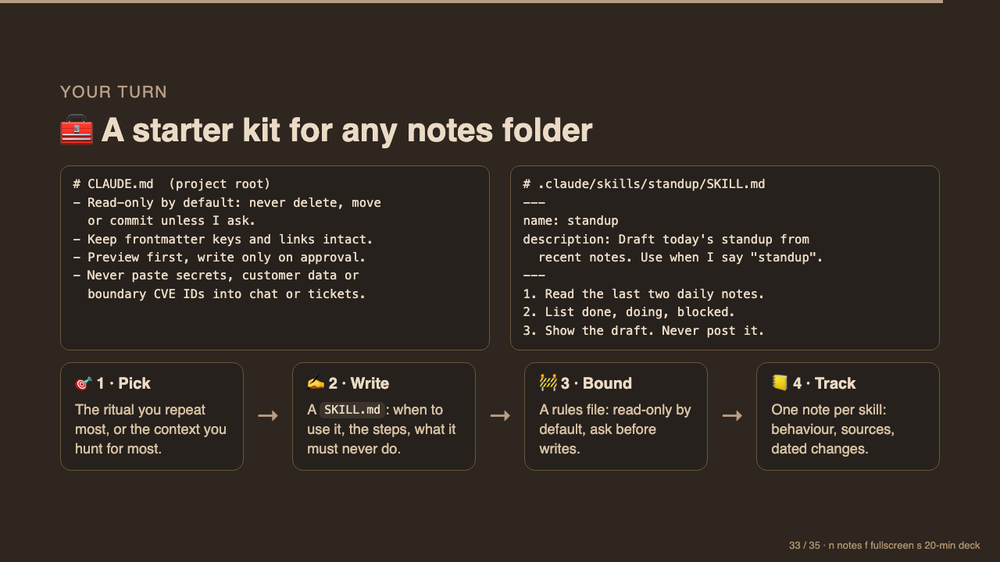

The copy-paste starter. On the left, a rules file: Claude Code reads `CLAUDE.md` at the start of every session. On the
right, a skill: a folder with a `SKILL.md` whose description says when to use it, placed under `.claude/skills/`. Start
with one that only reads and drafts, never one that posts; a release-notes digest against your own pins is a great first
one. Then bound it with rules and give it a tracking note.

## 34. Why it is shaped this way

⏱️ 20-min cut

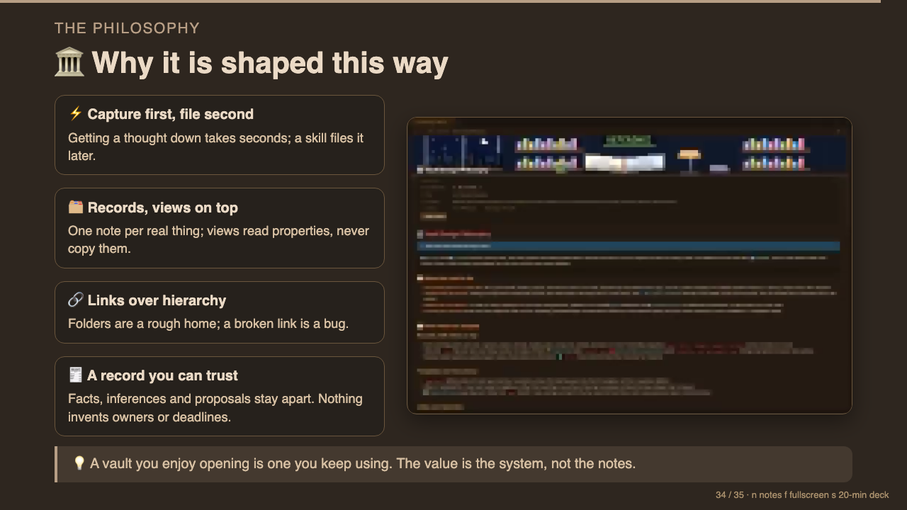

The thinking behind it, which Claude reads too: capture first and file second, records with views on top, links over
hierarchy, and a record you can trust, with facts, inferences and proposals kept apart and nothing invented. If you
remember one line: the value is the system, not the notes. The whole argument is in
[philosophy](../../docs/philosophy.md).

## 35. Questions?

⏱️ 20-min cut

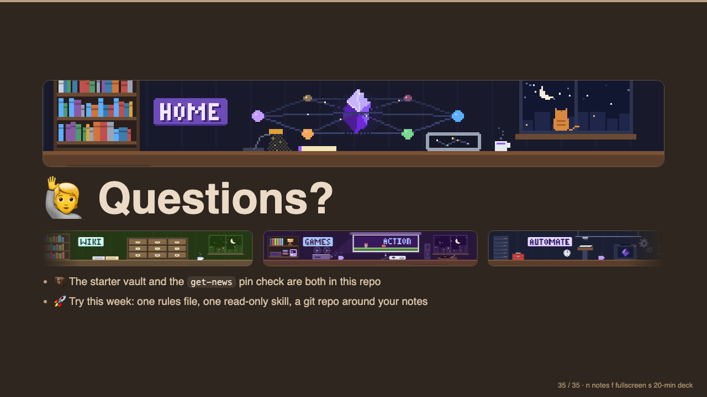

The takeaway again: one read-only skill for the thing you repeat most, a rules file, and a git repo around your notes. The
starter vault and the `get-news` pin check are both in this repo.

---

## Make your own

- **Start from the vault.** Copy [`vault-template/`](../../vault-template/README.md), open it in Obsidian, and follow
  [Obsidian setup](../../docs/obsidian-setup.md). Install the plugin as the [repo README](../../README.md#quick-start) shows.
- **Make it yours to look at.** [`pixel-banners`](../../plugins/vault-skills/skills/pixel-banners/) renders new banners
  with the engine in [`scripts/banners/`](../../scripts/banners/), in the same style as the ones in this deck.
- **Make your own deck.** `index.html` is plain HTML, CSS and a little JS with no build step. Each slide is a `<section>`;
  put speaker notes in `data-notes` and add `data-core` to the slides that belong in the short cut.
